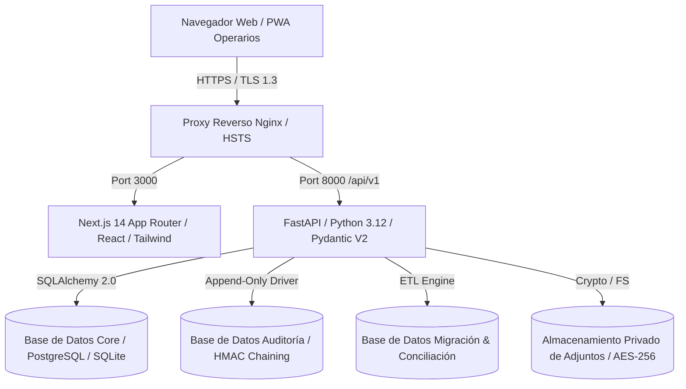

# Arquitectura del Sistema y Registro de Decisiones de Arquitectura (ADRs)
## Plataforma de Gestión de Cementerios Municipales (San Carlos y Cachapoal)

**Versión:** 2.0.0  
**Fecha:** 02 de Noviembre de 2026  
**Línea Base:** `Cemetery_Platform_Technical_Requirements.docx` (EETT 2026)

---

## 1. Visión General de la Arquitectura

La plataforma está diseñada bajo un modelo de arquitectura limpia desacoplada en tres capas principales:

### 1.1 Frontend (Capa de Presentación)
- **Framework:** Next.js 14 con TypeScript y App Router.
- **Estilos:** Tailwind CSS con variables CSS personalizadas para paletas municipales dinámicas (`/temas`).
- **Navegación:** Layout con barra lateral persistente colapsable (`AppSidebar`), header de accesibilidad y drawer deslizante de detalle (`PropertyDetailDrawer`).
- **Seguridad:** Manejo seguro de tokens JWT en memoria y LocalStorage, interceptor de sesión con timeout de inactividad de 30 minutos y control de hidratación seguro.

### 1.2 Backend (Capa de Negocio y APIs)
- **Framework:** FastAPI (Python 3.12+) con validación asíncrona y Pydantic V2.
- **ORM:** SQLAlchemy 2.0 con anotaciones de tipo modernas (`Mapped`, `mapped_column`).
- **Autenticación y RBAC:** OAuth2 Password Bearer con JWT, soporte de 2FA TOTP (RFC 6238), y matriz granular de permisos por módulo (`tb_grupo_permiso`).
- **Control de Acceso y Privacidad:** Filtros server-side para cumplimiento de la **Ley 21.719** (Protección de Datos Personales) y **Ley 20.584** (Derechos y Deberes en Salud / Causa de Defunción).

### 1.3 Capa de Datos y Persistencia
- **Particionamiento por Esquemas / Multi-Database:**
  - `core`: Datos operacionales (cementerios, ubicaciones, personas, derechos, inhumaciones, exhumaciones, certificados, reservas).
  - `audit`: Bitácora inmutable de eventos de auditoría (`tb_log_auditoria`), protegida por triggers a nivel de base de datos.
  - `migracion` / `staging`: Tablas temporales de migración, conciliación matemática y excepciones.
- **Motores Soportados:** PostgreSQL 16 (producción corporativa) y SQLite multi-db adjunto (`cem_core.db`, `cem_audit.db`, `cem_migration.db`) para entornos locales, CI/CD y simulacros de prueba.

---

## 2. Registro de Decisiones de Arquitectura (ADRs)

### ADR-001: Bitácora de Auditoría Inmutable (Append-Only) con Triggers Físicos en Base de Datos
- **Contexto:** Las bases técnicas (EETT 3.14 y Anexo 2 fila 17) exigen que ningún administrador ni usuario de la aplicación pueda alterar o eliminar registros de auditoría.
- **Decisión:** 
  1. Se implementó una cadena criptográfica HMAC-SHA256 (`cadena_hash_anterior` -> `hash_registro`) en cada evento de auditoría.
  2. Se crearon triggers físicos a nivel de base de datos (`trg_prevent_audit_update` y `trg_prevent_audit_delete`) en SQLite y la función `audit.prevent_audit_tampering()` en PostgreSQL.
  3. Todo intento de ejecutar `UPDATE` o `DELETE` sobre `tb_log_auditoria` es rechazado físicamente por el motor de base de datos mediante un error `ABORT` / `EXCEPTION`.
- **Consecuencias:** Integridad verificable matemáticamente. Cumplimiento estricto de auditoría forense municipal.

---

### ADR-002: Control de Concurrencia Optimista (OCC) para Prevenir Pérdida Silenciosa de Actualizaciones
- **Contexto:** Múltiples operadores en San Carlos y Cachapoal pueden acceder y modificar simultáneamente un mismo registro (ej. transferencias de sepultura o sepultaciones concurrentes).
- **Decisión:** 
  1. Se agregó la columna `version_id: Mapped[int] = mapped_column(Integer, default=1, nullable=False)` en los modelos operacionales críticos (`Ubicacion`, `Derecho`, `Inhumacion`).
  2. Se configuró `__mapper_args__ = {"version_id_col": version_id}` en SQLAlchemy.
  3. En `backend/app/main.py`, se implementó un manejador global de excepciones para `StaleDataError` que captura colisiones y emite un código HTTP `409 Conflict` estructurado en JSON.
- **Consecuencias:** Se elimina completamente la sobreescritura silenciosa de datos. El segundo usuario en guardar recibe una advertencia explícita y debe recargar la ficha.

---

### ADR-003: Capa de Redacción de Privacidad Server-Side (Leyes 21.719 y 20.584)
- **Contexto:** La causa de fallecimiento es dato sensible reservado (Ley 20.584). Los datos de contacto de compradores, titulares y familiares (teléfonos, direcciones, correos y RUT) están protegidos por la Ley 21.719 y no deben exponerse al perfil Visitante o público.
- **Decisión:** 
  1. La sanitización de datos se aplica obligatoriamente en el servidor (en endpoints de listado, fichas, búsquedas y exportaciones CSV).
  2. Si el usuario no cuenta con rol de Staff (`ADMINISTRADOR` o `ADMINISTRATIVO`), la causa de muerte se reemplaza por `[CONFIDENCIAL LEY 20.584]` y los teléfonos/direcciones por `[PROTEGIDO LEY 21.719]`.
  3. La página pública de verificación de certificados QR expone estrictamente 5 metadatos autorizados: Tipo de Certificado, Folio, Fecha de Emisión, Estado (`VIGENTE`/`CANCELADO`) y Hash SHA-256 del PDF.
- **Consecuencias:** Cumplimiento regulatorio legal estricto. Imposibilidad de extracción masiva o scraping de datos privados por actores externos.

---

### ADR-004: Normalización Acento-Insensible y Compatibilidad Ñ ≈ N en Búsqueda Instantánea
- **Contexto:** Los usuarios buscan registros históricos escritos indistintamente como "Muñoz", "munoz" o "MUNOZ", y RUTs con o sin puntos y guión.
- **Decisión:** 
  1. Se implementó la función escalar de base de datos `unaccent_sql` para SQLite y soporte de extensión `unaccent` en PostgreSQL.
  2. El buscador normaliza tokens eliminando tildes, diéresis y mapeando la letra `ñ` a `n` para concordancia fonética amplia, sin alterar los nombres canónicos almacenados.
  3. Los RUTs son limpiados de puntuación, permitiendo búsqueda directa por cuerpo numérico.
- **Consecuencias:** Búsquedas instantáneas en menos de 500 ms con tolerancia a errores ortográficos comunes en archivos históricos.

---

### ADR-005: Folios Correlativos Secuenciales sin Huecos (Gapless) por Tipo y Año
- **Contexto:** EETT 3.10 exige folios oficiales correlativos únicos por tipo de certificado y año calendario, garantizando que reimpresiones conserven el folio original y anulaciones mantengan la trazabilidad.
- **Decisión:** 
  1. El formato de folio estandarizado es `CERT-{TIPO[:3]}-{AÑO}-{SECUENCIA:05d}` (ej. `CERT-INH-2026-00001`).
  2. La secuencia se calcula con bloqueo atómico de conteo anual dentro de la transacción de base de datos.
  3. Los bytes exactos del PDF generado se persisten en la columna `pdf_bytes` de `tb_certificado`, asegurando que el hash SHA-256 corresponda siempre a los bytes descargables.
- **Consecuencias:** Cero folios duplicados o salteados. Validación fidedigna de autenticidad documental municipal.
